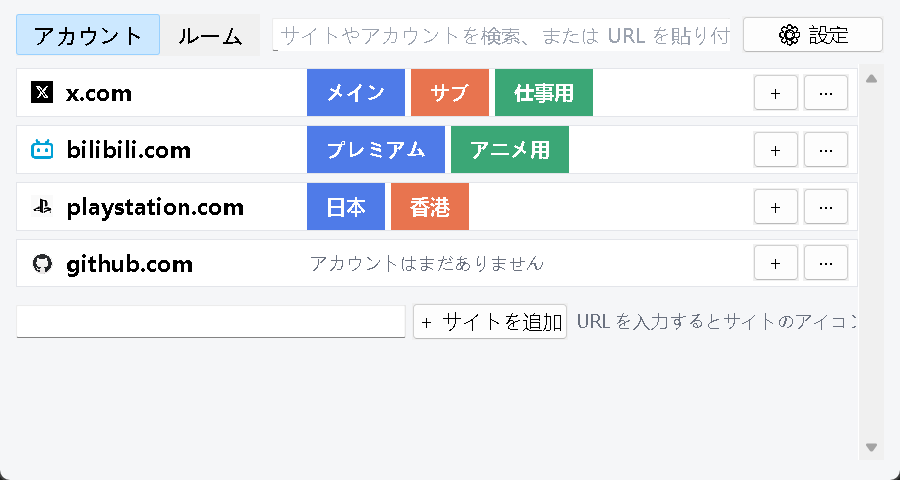
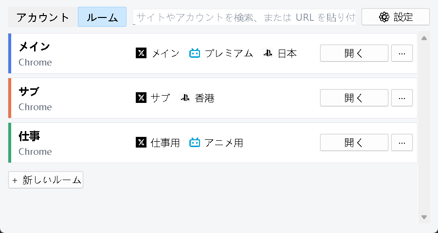

# Profile Router（ブラウザーアカウント切り替え）

[English](README.md) | [简体中文](README.zh-CN.md) | **日本語**

Windows で、サイトのアカウントをワンクリックで切り替えます。

Chrome などのブラウザーは複数の**プロファイル**を持て、それぞれがログイン状態を別々に保存します。Profile Router ではこれを**ルーム**と呼びます。「メイン」ルームには X のメインアカウント・bilibili・PSN（日本）を、「サブ」ルームには X のサブアカウント・PSN（香港）を——**X · サブ** をクリックすれば、X が対応するルームでログイン済みの状態で開きます。チャットやメール、文書から開いたリンクも、正しいアカウントで開けます。

Chrome、Edge、Brave、Vivaldi、SRWare Iron（Chromium 系）と Firefox に対応。画面は日本語・英語・簡体字中国語で、Windows の表示言語に合わせて切り替わります（設定で変更可）。

| アカウント | ルーム |
|---|---|
|  |  |

## 機能

- **「アカウント」ページ**：サイトごとに 1 行、サイトのアイコンとアカウントのボタン。クリックで切り替え。検索のほか、URL を貼り付けて Enter で正しいアカウントで開けます。
- **「ルーム」ページ**：各ルームとブラウザー、ログインしているアカウントの一覧。ブラウザーにある既存のプロファイルは自動でルームになり、ブラウザー側での追加・削除・名前変更も再起動なしで反映されます。
- **アカウント追加は 1 か所だけ**：名前を付けてルームを選ぶ（1 つのルームに同じサイトのアカウントは 1 つまで）か新しいルームを作り、開いたページで一度ログインするだけ。
- **ブラウザーのログイン・設定画面を出さずに新しいルームを作成**：ローカルプロファイルを直接作成し、他のルームから拡張機能（LastPass など）をコピーできます。Windows Hello に保存したパスキーはすべてのルームで使えます。
- **よく使うページ**：アカウントごとに数ページ（タイムライン、お気に入り、管理画面など）を保存し、切り替え時にまとめて開きます。
- **ショートカット**：アカウントやルームのショートカットをデスクトップやスタートメニューに作成。ブラウザーを直接起動します。
- **アカウントとルームの安全な削除**：アカウント削除時に、そのルームにあるサイトのログイン Cookie とサイトデータも削除できます（事前に警告、ブラウザーを閉じる必要あり）。ルームの削除はフォルダーをごみ箱へ移動します。ブラウザーのメインプロファイルと、ブラウザーアカウントでログイン中のプロファイルは削除できません。
- **既定のブラウザー（任意）**：既定のブラウザーに設定すると、他のアプリから開いたリンクも正しいアカウントで開くか、どれを使うか尋ねます。

## はじめかた

Windows と Python 3.10 以上が必要です（tkinter 同梱、他の依存なし）。

```bash
git clone https://github.com/linyvjinyang/profile-router.git
cd profile-router
pythonw run.pyw
```

## 本物のアカウントなしで試す

```bash
python tools/demo.py
```

ローカルの偽サイト 3 つ（`x.localhost`、`bili.localhost`、`psn.localhost`）を起動し、別のサンドボックスフォルダー（`.sandbox/`）にテスト用 Chrome ルームを 3 つ用意して、デモ設定でアプリを開きます。あなたのブラウザープロファイルや設定には触れません。アカウントをクリックすると、最初は偽サイトに「未ログイン」と表示されるので、対応する名前でログインしてください。以降は各ルームがそれぞれのアカウントを保ちます。

## 既定のブラウザー（任意）

設定で「既定のブラウザーに設定…」をクリックするか、`python -m profile_router --register` を実行します。現在の Windows ユーザー（HKCU）にのみ登録されるので、そのあと Windows の「設定 → アプリ → 既定のアプリ」で HTTP と HTTPS を Profile Router にしてください。

元に戻す：Windows の設定で既定のブラウザーを戻してから、`python -m profile_router --unregister` を実行します。

設定とアイコンは `%APPDATA%\ProfileRouter\` に保存されます。

## プライバシーとやらないこと

- ページを**どのプロファイルで**開くかを決めるだけです。ブラウザー標準のコマンドラインオプション（`--profile-directory`、`-P`）を使います。
- パスワード、Cookie の中身、その他のログイン情報は読みません。サイトのアカウントはあなたが登録します。
- ネットワーク通信は、追加したサイト自身からそのアイコンをダウンロードするときだけです。
- ブラウザー指紋の偽装や「アカウントの紐付け回避」はしません。

## 開発

```bash
uv run --group dev pytest -q
```

## ライセンス

[MIT](LICENSE)
