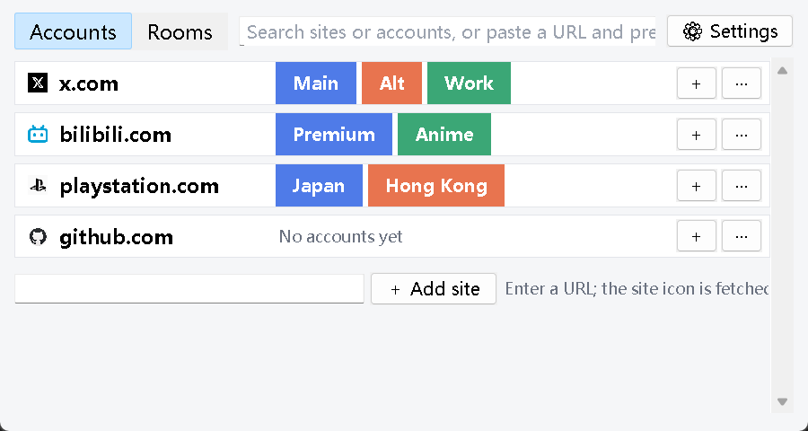
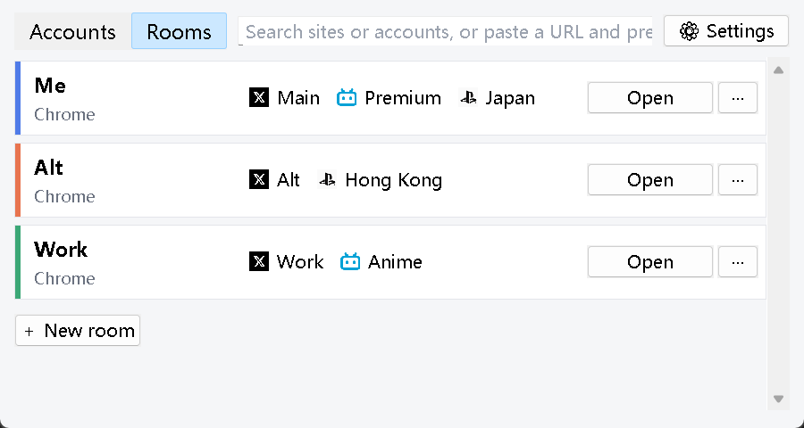

# Profile Router

**English** | [简体中文](README.zh-CN.md) | [日本語](README.ja.md)

Switch website accounts on Windows with one click.

Browsers like Chrome let you keep several **profiles**, each with its own logins. Profile Router calls them **rooms** and puts them to work: keep your main X account, your Bilibili account and your PlayStation account in the room "Me", your alt accounts in the room "Alt" — then click **X · Alt** and X opens in the right room, already logged in. Links you click in other apps (chat, mail, documents) can go to the right account too.

Works with Chrome, Edge, Brave, Vivaldi, SRWare Iron (Chromium-based) and Firefox. The UI is available in English, Simplified Chinese and Japanese and follows your Windows display language (changeable in Settings).

| Accounts | Rooms |
|---|---|
|  |  |

## Features

- **Accounts page** — one row per site with its icon and account buttons; click an account to switch to it. Search, or paste a link and press Enter to open it with the right account.
- **Rooms page** — every room with its browser and the accounts logged in there. Profiles that already exist in your browsers show up automatically, and changes made in the browsers are picked up without restarting.
- **Add an account in one place** — name it, pick a room (a room holds at most one account per site) or create a new one, then log in once on the page that opens.
- **New rooms without the browser's sign-in screens** — a local profile is created directly; you can copy extensions (e.g. LastPass) from another room. Passkeys stored in Windows Hello work in every room.
- **Pinned pages** — save a few pages per account (feed, favorites, dashboard…) that open together when you switch to it.
- **Shortcuts** — create desktop or Start menu shortcuts for an account or a room; they launch the browser directly.
- **Delete accounts and rooms safely** — deleting an account can also remove that site's login cookies and data from its room (you are warned first; the browser must be closed). Deleting a room moves its folder to the Recycle Bin. The browser's main profile and profiles signed in to a browser account cannot be deleted.
- **Default browser (optional)** — register Profile Router as your default browser so links from other apps open with the right account, or ask which one to use.

## Getting started

Requires Windows and Python 3.10+ (tkinter is included; no other dependencies).

```bash
git clone https://github.com/linyvjinyang/profile-router.git
cd profile-router
pythonw run.pyw
```

## Try it without real accounts

```bash
python tools/demo.py
```

This starts three local fake sites (`x.localhost`, `bili.localhost`, `psn.localhost`), prepares three test Chrome profiles in a separate sandbox folder (`.sandbox/`) and opens the app with a demo configuration. Your own browser profiles and settings are not touched. Click an account: the fake site shows "not logged in" the first time — log in with the matching name, and from then on each room stays logged in as its own account.

## Default browser (optional)

In Settings click "Set as default browser…", or run `python -m profile_router --register`. This only registers Profile Router for the current Windows user (HKCU); then choose it for HTTP and HTTPS in Windows Settings → Apps → Default apps.

To undo: switch the default browser back in Windows Settings, then run `python -m profile_router --unregister`.

Settings and icons are stored in `%APPDATA%\ProfileRouter\`.

## Privacy and what it does not do

- It only decides **which profile** opens a page, using the browsers' own command-line options (`--profile-directory`, `-P`).
- It never reads passwords, cookie values or other login data. Site accounts are registered by you.
- The only network access is downloading the icon of a site you add, from that site itself.
- No fingerprint spoofing, no "anti-association" features.

## Development

```bash
uv run --group dev pytest -q
```

## License

[MIT](LICENSE)
