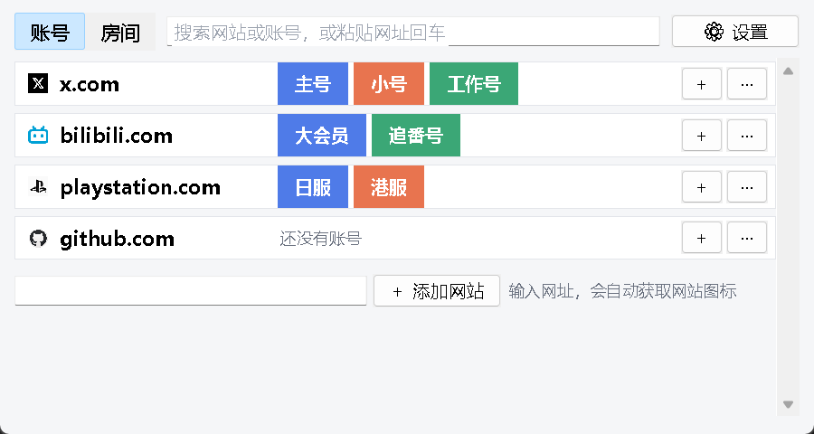
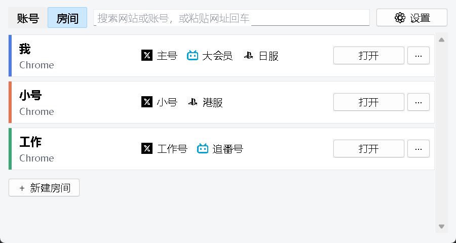

# Profile Router（浏览器账号切换）

[English](README.md) | **简体中文** | [日本語](README.ja.md)

在 Windows 上一键切换网站账号。

Chrome 这类浏览器可以有多个**用户**，每个用户各自保存登录状态。Profile Router 把它们叫作**房间**：「我」这个房间里登录 X 主号、B站大会员、PSN 日服，「小号」房间里登录 X 小号、PSN 港服——点一下 **X · 小号**，X 就在对应的房间里打开，已经是登录状态。从聊天软件、邮件、文档里点开的链接，也能送到对的账号。

支持 Chrome、Edge、Brave、Vivaldi、SRWare Iron（Chromium 系）和 Firefox。界面有简体中文、日文、英文，默认跟随 Windows 的显示语言（可在设置里改）。

| 账号 | 房间 |
|---|---|
|  |  |

## 功能

- **「账号」页**：每个网站一行，带网站图标和账号按钮，点账号就切换。可以搜索，也可以粘贴网址回车，用对的账号打开。
- **「房间」页**：列出每个房间、所属浏览器和里面登录的账号。浏览器里已有的用户自动算作房间；在浏览器里新建、删除、改名用户，不用重启就会同步过来。
- **添加账号只有一个入口**：填账号名，选一个房间（同一房间里同一网站只放一个账号）或新建房间，然后在打开的页面里登录一次。
- **新建房间不弹浏览器的登录、设置页面**：直接建本地用户，可以从别的房间复制扩展（比如 LastPass）。Windows Hello 里存的通行密钥所有房间都能直接用。
- **常用页**：给每个账号存几个页面（动态、收藏夹、创作中心……），切到这个账号时一起打开。
- **每个房间的启动项**：比如不提示"设为默认浏览器"、异常关闭后不弹"要恢复页面吗"、跳过首次运行页面、启动时最大化、静音、网页强制深色，也可以填自己的参数。每一项都会对照你装的浏览器版本检查，这个版本已经没有的会变灰。启动项在浏览器启动时生效（同一个浏览器的所有房间共用一个进程）。
- **快捷方式**：给账号或房间生成桌面、开始菜单快捷方式，直接启动浏览器。
- **安全地删除账号和房间**：删除账号时可以同时清除该网站在这个房间里的登录 Cookie 和网站数据（会先提醒，需要先关浏览器）。删除房间会把文件夹移到回收站。浏览器的主用户、登录着浏览器账号的用户不能删。
- **默认浏览器（可选）**：设成默认浏览器后，别的软件里点开的链接也会用对的账号打开，或者弹窗问你用哪个。

## 开始使用

需要 Windows 和 Python 3.10 以上（自带 tkinter，无其他依赖）。

```bash
git clone https://github.com/linyvjinyang/profile-router.git
cd profile-router
pythonw run.pyw
```

## 不用真账号试一试

```bash
python tools/demo.py
```

会启动三个本地假网站（`x.localhost`、`bili.localhost`、`psn.localhost`），在单独的沙盒文件夹 `.sandbox/` 里准备 3 个 Chrome 测试房间，并用演示配置打开程序——不碰你自己的浏览器用户和设置。点任意账号：第一次假网站显示「未登录」，点对应的名字登录；之后每个房间都各自保持自己的账号。

## 默认浏览器（可选）

在设置里点「设为默认浏览器…」，或运行 `python -m profile_router --register`。这一步只在当前 Windows 用户下（HKCU）登记，然后在 Windows「设置 → 应用 → 默认应用」里把 HTTP、HTTPS 改成 Profile Router。

撤销：先在 Windows 设置里把默认浏览器改回去，再运行 `python -m profile_router --unregister`。

设置和图标保存在 `%APPDATA%\ProfileRouter\`。

## 隐私，以及不做什么

- 只决定**用哪个浏览器用户**打开页面，用的是浏览器自带的命令行参数（`--profile-directory`、`-P`）。
- 不读取密码、Cookie 内容或其他登录数据；网站账号由你自己登记。
- 唯一的联网是从你添加的网站本身下载它的图标。
- 不做浏览器指纹伪装，不做"防关联"。

## 开发

```bash
uv run --group dev pytest -q
```

## 许可

[MIT](LICENSE)
